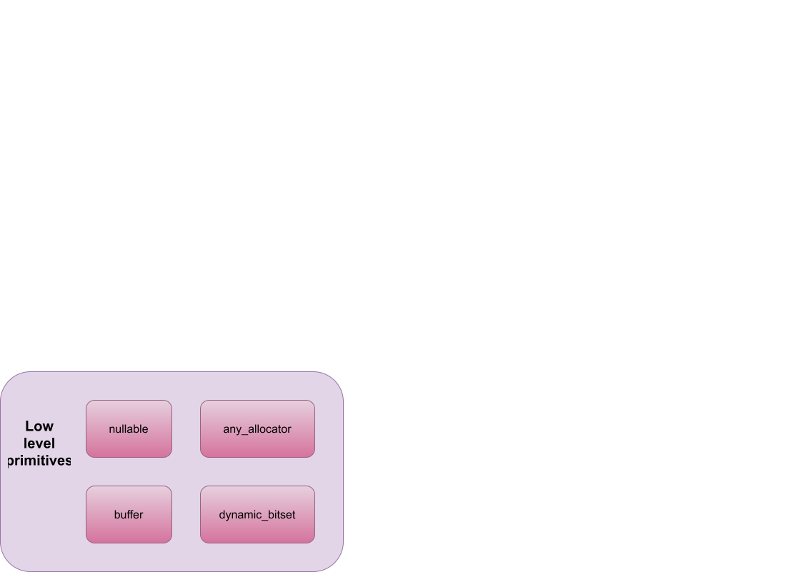
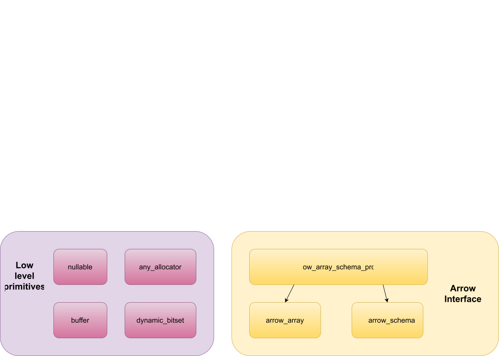
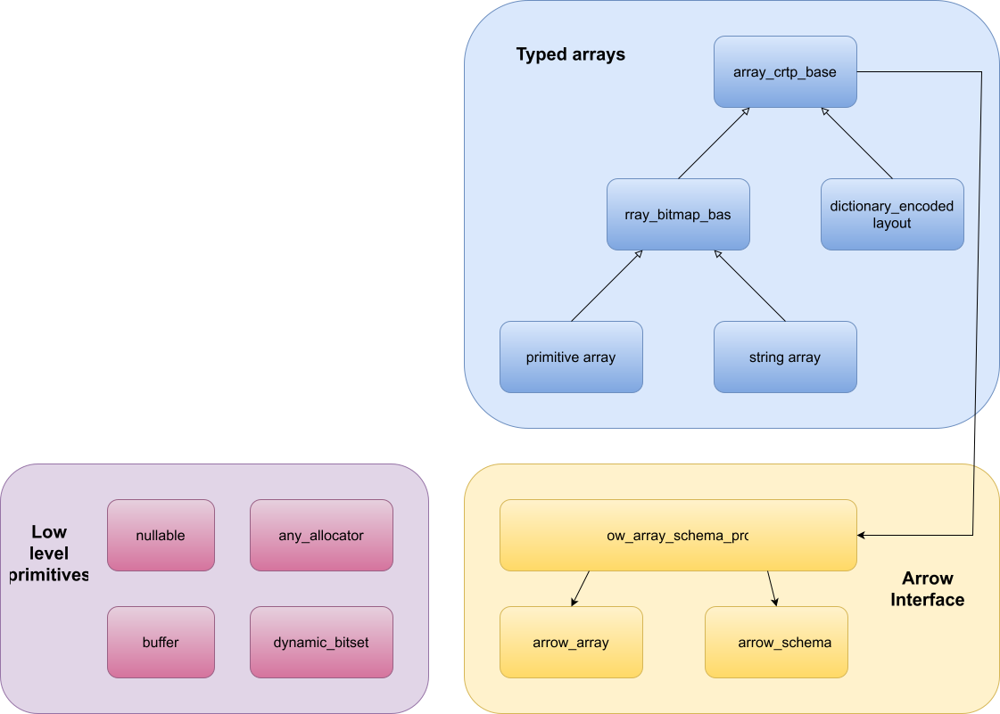
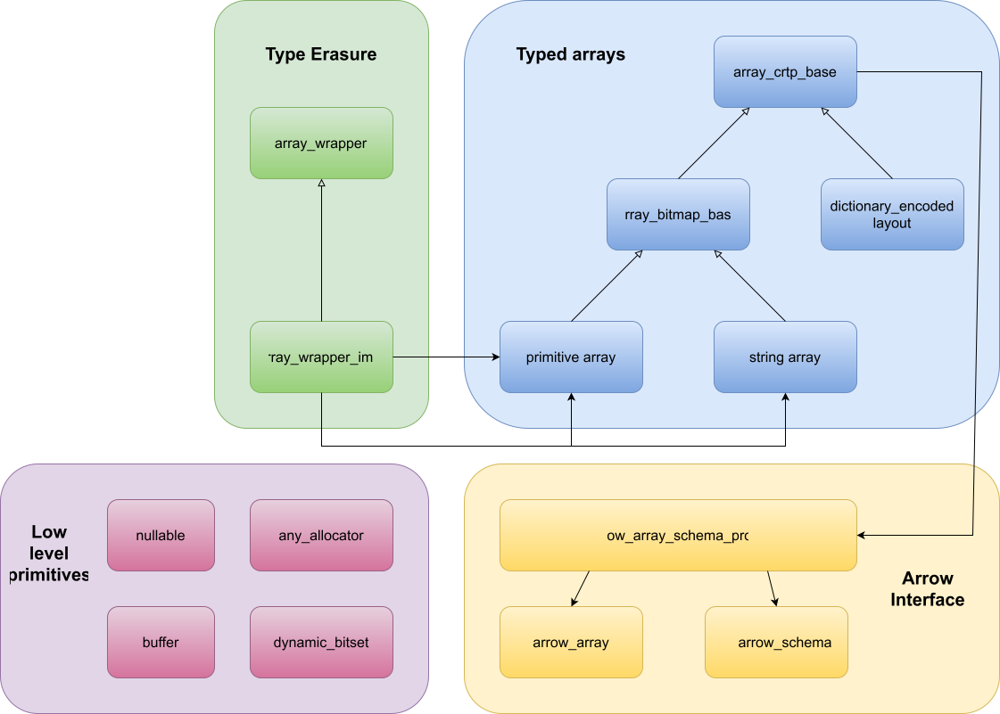
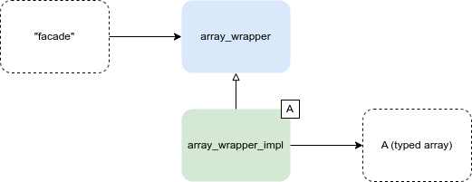
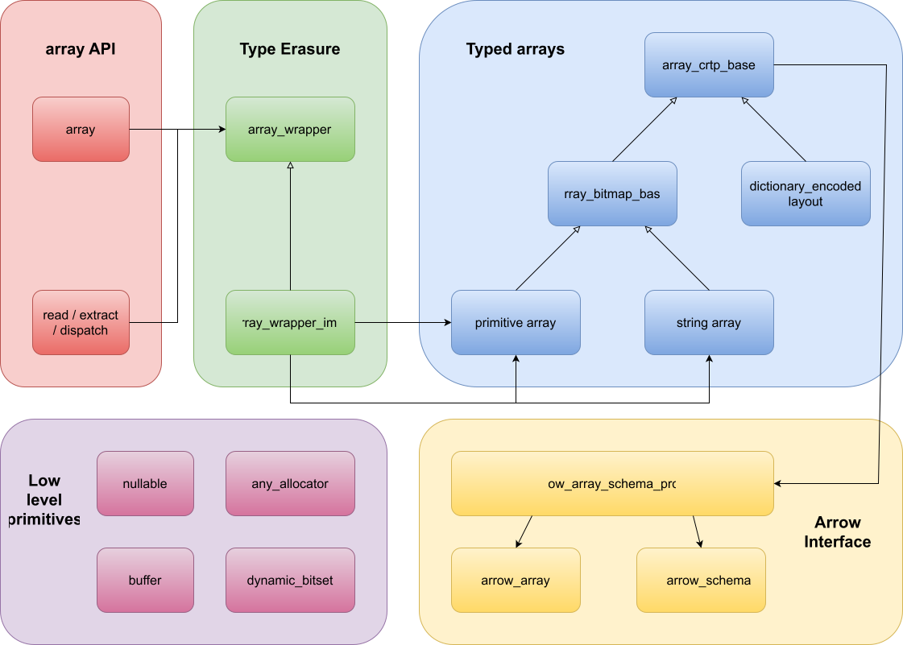

<h1>The Sparrow ecosystem: Arrow in modern minimal C++20</h1>
<h2>Compute! - November 2026</h2>
<h4>Johan Mabille</h4>
<h4>Alexis Placet</h4>
 
 

---
# About

<table class="invisible-table">
    <tr>
        <td>
            
            <strong>Johan Mabille</strong> 
            Technical Director at QuantStack 
            Contributor to Jupyter, mamba, xtensor
        </td>
        <td>
            
            <strong>Alexis Placet</strong> 
            Software Engineer at QuantStack 
            Contributor to Sparrow, xtensor, emscripten-forge, cockle
        </td>
    </tr>
</table>

---

# Why Sparrow ?

* Apache Arrow's tabular format has become the industry standard
* Apache Arrow is a huge monorepo with many dependencies, while some projects only need the memory format implementation (e.g., ArcticDB)
* Apache Arrow started more than 10 years ago, and C++20 brought new features that we can leverage in a fresh, modern project

---

# What are Sparrow libraries ?

Idiomatic C++20 implementations of the Apache Arrow memory format + canonical extensions, IPC and PyCapsule featuring
* value semantics, ranges, and iterators ...
* Support for both typed and untyped arrays
* Mutability for typed arrays
* Convenient constructors and builders for easy usage
* Built-in std::formatters for all Sparrow types

---

# Sparrow properties

* Zero dependencies for Sparrow
  * ... except when compiling with libc++ (P0355R7 Timezone)
  * ... zstd and lz4 if support for compressed IPC
* Passes all Apache Arrow integration tests, compatible with formats 1.0 to 1.5
* Packaged for Conda, Conan, Fedora and vcpkg
* Licensed under Apache License v2 or BSD

---

# Architecture

---

---

# Low level primitives:

* nullable: represents null values, API similar to std::optional
* dynamic_bitset: "Compressed" buffer of boolean
* buffer: std::vector-like, able to take ownership of C-allocated arrays
* any_allocator: type erasure for allocators

---

---

# Arrow interface:

* Proxy classes over ArrowArray and ArrowSchema
* Can have ownership of ArrowArray and ArrowSchema

---

---

# Typed arrays

* One array class per layout (more than 10 layouts + variations)
* 2 kinds of layouts: nested and non-nested
* All arrays provide almost the same API

---

---

# Type erasure

---

---

# [Sparrow demo: arrays](../notebooks/index.html?path=sparrow.ipynb)

<iframe class="demo" src="../notebooks/index.html?path=sparrow.ipynb" loading="lazy"></iframe>

---

# [Sparrow demo: IPC between C++ and pyarrow](../notebooks/index.html?path=sparrow-ipc.ipynb)

<iframe class="demo" src="../notebooks/index.html?path=sparrow-ipc.ipynb" loading="lazy"></iframe>

---

# [Sparrow demo: compute](../notebooks/index.html?path=sparrow-compute.ipynb)

<iframe class="demo" src="../notebooks/index.html?path=sparrow-compute.ipynb" loading="lazy"></iframe>

---

# [Sparrow demo: rockfinch](../notebooks/index.html?path=rockfinch.ipynb)

<iframe class="demo" src="../notebooks/index.html?path=rockfinch.ipynb" loading="lazy"></iframe>

---

# What's Next

* Sparrow tables
* More computation kernels
* GeoArrow

---

# Contributors

<table class="invisible-table" style="table-layout: fixed">
  <tr>
    <td style="text-align: center; width: 200px;">
      
      <strong>Alexis Placet</strong> 
      @Alex-PLACET
    </td>
    <td style="text-align: center; width: 200px;">
      
      <strong>Johan Mabille</strong> 
      @JohanMabille
    </td>
    <td style="text-align: center; width: 200px;">
      
      <strong>Thorsten Beier</strong> 
      @DerThorsten
    </td>
  </tr>
  <tr>
    <td style="text-align: center; width: 200px;">
      
      <strong>Joël Lamotte</strong> 
      @Klaim
    </td>
    <td style="text-align: center; width: 200px;">
      
      <strong>Julien Jerphanion</strong> 
      @jjerphan
    </td>
    <td style="text-align: center; width: 200px;">
      
      <strong>Hind Montassif</strong> 
      @Hind-M
    </td>
  </tr>
</table>

---

# Thanks !

# Resources

- Apache Arrow specification: https://arrow.apache.org/docs/format/Columnar.html
- Github repositories:
  - sparrow: https://github.com/sparrow-org/sparrow
  - sparrow-ipc: https://github.com/sparrow-org/sparrow-ipc
  - sparrow-rockfinch: https://github.com/sparrow-org/sparrow-rockfinch
  - sparrow-compute: https://github.com/sparrow-org/sparrow-compute
- Documentation: https://sparrow-org.github.io/sparrow/index.html
- Try it online (JupyterLite): https://alex-placet.github.io/compute2026-sparrow-presentation/lab/index.html

